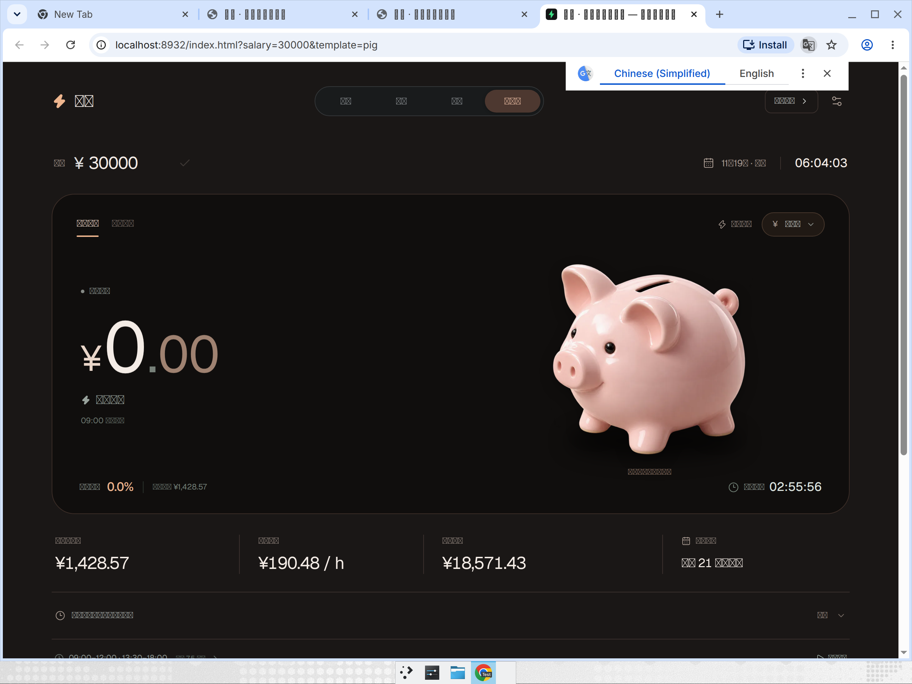

# 薪动 · 每一秒，都算数

> 输入月薪，看着收入按秒跳动。一个免费、免注册、纯本地的实时工资秒表。



[](https://xd.syal.site/)
[](https://github.com/LCYLYM/test-devin/actions/workflows/site-check.yml)


## 它能做什么

| 能力 | 说明 |
| --- | --- |
| 实时秒表 | 月薪按当月实际工作日分摊到每一秒，工作时段内数字滚动 |
| 中国节假日 | 内置 2025/2026 法定节假日与调休补班，自动扣假、自动补班 |
| 自定义排班 | 固定双休、自定义每周工作日、单日期手动调整 |
| 加班 | 加班计时器 + 按天补记，算出真实时薪 |
| 多币种 | Frankfurter 实时汇率换算，含「津巴布韦 · 亿万富翁」趣味模式 |
| 分享海报 | 一键生成 1080×1440 收入海报 + 二维码 |
| 十一种皮肤 | 存钱罐（默认）/ 充电 / 刻度 / 像素 / 霓虹 / 极简 / 纸墨 / 终端 / 心电 / 水球 / 温度 |

## 深链分享

把月薪和皮肤写进链接，发给朋友开箱即用：

```
https://xd.syal.site/?salary=30000&template=pig&demo=1
```

| 参数 | 取值 |
| --- | --- |
| `salary` | 月薪数字，如 `15000` |
| `template` | `pig` / `charge` / `meter` / `pixel` / `neon` / `mono` / `paper` / `term` / `ecg` / `wave` / `therm` / `receipt`（`skin` 同义，`random`/`daily` 特殊值） |
| `currency` | `CNY` / `USD` / `EUR` / `JPY` / `KRW` / `HKD` / `VND` / `IDR` / `GBP` / `SGD` / `AUD` / `ZIM` |
| `period` | `day` / `month` |
| `demo` | `1` 开启演示模式（数字可设倍速，如 `60`） |
| `focus` | `salary` 打开时聚焦月薪输入 |
| `zen` | `1` 进入专注模式 |
| `sound` | `1` 开启音效 |
| `accent` | 自定义强调色（hex 或 CSS 颜色名），`off` 清除（记忆） |
| `dialog` | `share\|about\|settings\|goal\|calendar\|currency\|overtime` 直接打开面板 |
| `title` | `0` 关闭标签页金额跳动 |
| `payday` | `1`–`31` 发薪日倒计时（记忆，`0` 清除） |
| `work` | 工作时段，如 `0900-1200,1330-1800` |
| `goal` | 金额，配合 `goalname` 预填小目标 |
| `hide` | 隐藏区块：`header,footer,faq,utility,summary,overtime,bottom,toolbar,foot,badges` |
| `embed` | `1` 隐藏页头页脚 FAQ，适合 iframe 嵌入 |
| `vs` | 等价物换算徽章：`?vs=奶茶@15` 显示「≈ N 杯奶茶」 |
| `avg` | 时薪对比徽章：`?avg=8000` 显示你的时薪 vs 均值 |
| `pet` | 给存钱罐小猪起名：`?pet=旺财` |
| `confetti` | `0` 关闭达成 100% 时的撒花 |
| `dec` | 金额小数位 `2`–`6`（配 `?demo=` 高速演示更爽） |
| `rate` | 费率单位：`sec`/`min`/`hour`（同点按费率胶囊，记忆） |
| `bg` | 自定义页面背景（hex 或 CSS 颜色名），`off` 清除（记忆） |
| `emoji` | 状态角标 emoji：`?emoji=🔥` |
| `quote` | `1` 每日打工人语录，或自定义文本 `?quote=摸鱼万岁`（`q` 键切换，记忆） |
| `clock` | `12` 使用 12 小时制时钟 |
| `keys` | `0` 禁用全部快捷键（嵌入场景） |
| `milestone` | `25,100` 自定义破额提醒阈值；`0` 关闭（默认 10/20/50/100/200/500/1000） |
| `light` | `1` 浅色模式（`l` 键切换，记忆本地） |
| `symbol` | 自定义货币符号，≤3 字符，如 `?symbol=€` `?symbol=💰` |
| `theme` | `light` / `dark` / `auto`（auto 跟随系统） |
| `brand` | 自定义左上角品牌名，≤12 字符 |
| `dir` | `down` 倒计时模式：显示距离目标还差多少 |
| `size` | `0.4–2.5` 数字区缩放（电视/投屏用） |
| `fx` | `snow` / `sakura` / `rain` / `matrix` 全屏氛围特效（配专注模式绝配） |
| `vibrate` | `1` 里程碑/达标时手机震动 |
| `compact` | `0` 关闭 万/亿 大数缩写，始终显示完整数字 |
| `ms` | `1` 显示"距下个里程碑还差多少"徽章 |
| `luck` | `1` 每日财运签徽章（按日期抽签） |
| `bgimg` | 背景图 URL（https://），如 `?bgimg=https://…` |
| `badge` | 自定义徽章文字，≤20 字（`?badge=老板别点`） |
| `caption` | 自定义数字下方说明文字，≤40 字 |
| `ss` | 秒数，无操作 N 秒后自动进入专注模式（数字相框） |
| `mirror` | `1` 页面水平镜像（投到镜子/玻璃上用） |
| `streak` | `1` 显示连续打卡天数徽章（🔥） |
| `earn` | 目标金额，`?earn=100` → 倒计时「再 H:MM:SS 到手 ¥100」 |
| `kiosk` | 秒数，每隔 N 秒自动轮换皮肤（`?kiosk=1` 默认 15s），电视/展示模式 |
| `favicon` | 自定义标签页图标 emoji，如 `?favicon=🔥` |
| `crt` | `1` CRT 扫描线滤镜（复古显示器质感） |
| `invert` | `1` 反色滤镜（投影/特殊显示用） |
| `anni` | 纪念日倒计时 `?anni=12-25`，配 `?anniname=名字` 自定义 |
| `year` | `1` 显示今年进度徽章（百分比） |
| `speed` | 演示模式时间流速倍率 `1`–`200`（配 `?demo=`） |
| `toast` | 打开时弹一条自定义提示，≤40 字（`?toast=欢迎老板`） |
| `cn` | `1` 金额旁显示中文数字读法（一二三点四五） |
| `glass` | `1` 毛玻璃面板（配 `?bgimg=` 绝配） |
| `pomodoro` | 番茄钟 `?pomodoro=25` 或 `25,5`（搬砖/摸鱼轮换提醒） |
| `rgb` | `1` 彩虹流转强调色（电竞氛围） |
| `breath` | `1` 仪表盘呼吸灯发光 |
| `notify` | `1` 里程碑到账时发系统通知（需授权） |
| `bw` / `sepia` | `1` 黑白 / 怀旧棕色滤镜 |
| `season` | `auto` 按季节自动特效（冬雪·春樱·夏雨） |
| `friday` | `1` 周五倒计时徽章 |
| `bday` | `MM-DD` 生日倒计时徽章（当天🎂） |
| `spark` | `1` 今日收入迷你走势图 |
| `dim` | `22-6` 该时段自动调暗 55%（夜间保护） |
| `contrast` | `1` 高对比模式（无障碍） |
| `visits` | `1` 累计打开次数徽章（localStorage 计数） |
| `chime` | `1` 整点报时音（需先开 `?sound=1`） |
| `logo` | emoji 自定义左上角图标（如 `?logo=🐷`） |
| `grad` | `1` 缓慢流动的渐变背景 |
| `from` | 名字，访客打开时弹「xxx 喊你一起来数钱」（分享链接会自动保留 `utm_*`/`from`） |
| `moon` | `1` 月相徽章（朔望盈亏 emoji） |
| `all` | `1` 累计入账徽章（本机逐日记录求和） |
| `shake` | `1` 手机摇一摇彩蛋（抖出钱来） |
| `ticker` | 文本，金额下方滚动字幕（≤80 字符） |
| `count` | `1` 打开时数字从 0 滚动到当前金额 |
| `bg` | 十六进制颜色，自定义背景（如 `?bg=1a2b3c`） |
| `hourly` | 时薪数字，自动换算成月薪填入（按当前工时） |
| `week` | `1` 本周进度徽章 |
| `glow` | `1` 金额辉光 + 状态点脉冲 |
| `shift` | 工作时段，如 `9-18` 或 `9-12,13-18`（覆盖排班，最多 4 段） |
| `light` | `1` 浅色 / `0` 深色 / `auto` 白天（7–19 点）浅色 |
| `eink` | `1` 墨水屏模式：去色 + 关掉所有动画 |
| `daily` | 日薪数字，自动换算成月薪填入 |
| `quarter` | `1` 本季度进度徽章（Q1–Q4） |
| `font` | `mono`/`serif`/`round` 切换金额字体 |
| `zodiac` | `1` 当年生肖徽章 |
| `jieqi` | `1` 二十四节气倒计时徽章 |
| `days` | 工作日覆盖，如 `1-5` 或 `0,1,2`（0=周日，本次会话生效） |
| `pal` | 配色包：`forest`/`ocean`/`sunset`/`grape`/`vapor` |
| `flat` | `1` 扁平化：去圆角、去阴影 |
| `reset` | `1` 清空本地全部数据并回到初始状态 |
| `idle` | 秒数，无操作 N 秒后自动进入专注模式，动一下恢复 |
| `wake` | `1` 屏幕常亮（Wake Lock，挂屏展示用） |
| `tap` | `1` 点金额蹦出金币彩蛋 |
| `holiday` | `1` 下个法定节假日倒计时（放假中显示节名） |
| `cny` | `1` 春节倒计时徽章（春节快乐 🧧） |
| `yuan` | `1` 距下一个整元倒计时徽章 |
| `pace` | `1` 实时时薪徽章 |
| `blink` | `1` 金额末尾闪烁光标 |
| `astro` | `MM-DD` 星座徽章（♈白羊…） |
| `rank` | `1` 时薪打败全网百分比（娱乐） |
| `banner` | 文字：页面顶部公告条 |
| `zoom` | `50`–`200` 显示缩放（%），挂屏/大屏用 |
| `mirror` | `1` 镜像仪表盘（彩蛋） |
| `lot` | `1` 今日幸运数字徽章 |
| `lock` | `1` 锁定月薪输入（挂屏/分享防改） |
| `ddl` | `YYYY-MM-DD` 或 `MM-DD` 自定义截止倒计时（`ddlname=` 改名） |
| `noise` | `1` 胶片颗粒滤镜 |
| `grid` | `1` 蓝图网格背景 |
| `corner` | emoji：右下角浮动小宠物 |
| `tips` | `1` 页脚轮换显示隐藏玩法提示 |
| `lunar` | `1` 农历日期徽章 |
| `yi` | `1` 今日宜忌徽章（娱乐） |
| `fx` | `…|bubble` 泡泡上升特效 |
| `spot` | `1` 鼠标追光聚光灯 |
| `tilt` | `1` 仪表盘 3D 视差倾斜 |
| `gloss` | `1` 周期玻璃高光扫过 |
| `orb` | `1` 环绕仪表的光点 |
| `steady` | `1` 关闭数字滚动动画（低功耗/无障碍） |
| `mins` | `1` 今日已搬砖时长徽章 |
| `grade` | `1` 时薪段位徽章（S/A/B/C/D，娱乐） |
| `lava` | `1` 熔岩光斑背景 |
| `fx` | `…|ember` 余烬上升特效 |
| `preset` | 预设组合：`focus`/`kiosk`/`party` |
| `bar` | `1` 页面顶部今日进度条 |
| `date` | `1` 日期星期徽章 |
| `card` | `1` 每日塔罗徽章（娱乐） |
| `fx` | `…|firefly|dust|meteor|warp|cloud` 萤火虫/浮尘/流星/跃迁/云朵 |
| `pulse` | `1` 金额心跳脉动 |
| `aurora` | `1` 极光背景 |
| `day` | `1` 白昼进度徽章 |
| `halo` | `1` 仪表辉光边框 |
| `fade` | `1` 入场渐显动画 |
| `vig` | `1` 暗角滤镜 |
| `round` | `1` 超圆角仪表 |
| `border` | `HEX` 自定义仪表边框色 |
| `ripple` | `1` 点击涟漪 |
| `drift` | `1` 悬浮漂移 |
| `wide` | `1` 超宽布局 |
| `rb` | `1` 彩虹边框 |
| `slim` | `1` 细体字重 |
| `cursor` | emoji 自定义光标 |
| `lift` | `1` 浮起深阴影 |
| `glitch` | `1` 故障风 |
| `shimmer` | `1` 速率流光 |
| `fog` | `1` 雾气背景 |
| `cinema` | `1` 电影黑边 |
| `frame` | `1` 相框边框 |
| `amber` | `1` 琥珀单色屏 |
| `dots` | `1` 波点背景 |
| `tile` | `1` 棋盘格背景 |
| `outline` | `1` 描边数字 |
| `rays` | `1` 光束背景 |
| `stripe` | `1` 斜条纹背景 |
| `disco` | `1` 色相旋转 |
| `wiggle` | `1` 徽章摇摆 |
| `born` | `YYYY-MM-DD` 来到地球天数徽章 |
| `hue` | `0`–`360` 仪表色相偏移 |
| `bezel` | `1` 浮雕边框 |
| `sway` | `1` 仪表轻摇摆 |
| `band` | `1` 金额高亮带 |
| `mood` | `1` 今日打工心情徽章（娱乐） |
| `stamp` | `1` 打卡印章 |
| `tock` | `1` 金额每秒轻跳 |
| `gains` | `1` 每秒收益飘字 |
| `fx` | `…|cloud` 云朵漂移
| `fx` | `…|paper` 纸飞机 |
| `fx` | `…|fireworks` 烟花 |
| `hour` | `1` 当前小时进度徽章 |
| `greet` | `1` 时段问候徽章 |
| `sat` | `0`–`200` 仪表饱和度（%） |
| `wotd` | `1` 今日打工词条徽章（娱乐） |
| `half` | `1` 上下半场进度徽章 |
| `month` | `1` 本月进度徽章 |
| `horizon` | `1` 地平线光带 |
| `sign` | 文字：右下角签名档 |
| `frost` | `1` 霜冻玻璃仪表 |
| `led` | `1` LED 辉光数字 |
| `sky` | `1` 背景随时刻变化（晨/昼/暮/夜） |
| `weeks` | `1` 今年第几周徽章 |
| `flick` | `1` 胶片闪烁 |
| `eq` | `1` 左下角均衡器律动 |
| `rt` | `1` 彩虹流动数字 |
| `dual` | `1` 上下分色仪表 |
| `bold` | `1` 数字加粗 |
| `hex` | `1` 今日幸运色徽章 |
| `spin` | `1` 徽章图标旋转 |
| `pop` | `1` 徽章弹出入场 |
| `lum` | `40`–`160` 仪表亮度（%） |
| `rail` | `1` 页面底部进度轨 |
| `hover` | `1` 徽章悬停上浮 |
| `trail` | `1` 鼠标拖尾光点 |
| `pillar` | `1` 两侧细柱线 |
| `gloom` | `1` 更暗氛围 |
| `owl` | `1` 作息标签徽章（夜猫子/小蜜蜂） |
| `workday` | `1` 工作日/休息日徽章 |
| `turn` | `1` 仪表翻转入场 |
| `yearday` | `1` 今年第几天徽章 |
| `left` | `1` 距今日目标还差徽章 |
| `warm` | `1` 暖色调滤镜 |
| `uptime` | `1` 本页停留时长徽章 |
| `tea` | `1` 下午茶时段提醒徽章 |
| `breathe` | `1` 仪表呼吸缩放 |
| `hours` | `1` 今日工时进度徽章 |
| `charm` | `1` 每日幸运符徽章 |
| `prism` | `1` 棱镜彩虹描边 |
| `lunch` | `1` 干饭时段提醒徽章 |
| `off` | `1` 收工状态徽章 |
| `water` | `1` 喝水提醒徽章（工作时段） |
| `stretch` | `1` 久坐提醒徽章（每小时前10分） |
| `fortune` | `1` 每日打工金句 |
| `xmas` | `1` 圣诞灯串装饰 |
| `sq` | `1` 方角仪表 |
| `compact` | `1` 紧凑模式 |
| `advent` | `1` 圣诞倒计时徽章（±40 天内显示） |
| `newyear` | `1` 元旦倒计时徽章 |
| `week7` | `1` 近7天累计入账徽章 |
| `tabearn` | `1` 页签标题实时金额 |
| `title` | `文字` 自定义页签标题 |
| `over` | `1` 加班补贴徽章（当日记加班且配了加班费时显示金额） |
| `fson` | `1` 首次点击自动全屏（挂屏用） |
| `opacity` | `20-100` 仪表整体透明度 |
| `fps` | `1` 渲染帧率徽章 |
| `bat` | `1` 设备电量徽章（支持设备） |
| `net` | `1` 网络在线状态徽章 |
| `yd` | `1` 昨日入账徽章（读本机累计记录） |
| `tapn` | `1` 手速徽章（每分钟点击次数） |
| `quiet` | `1` 静默模式：隐藏提示气泡/点击涟漪/撒花 |
| `sec` | `1` 秒薪徽章（每秒工资） |
| `alt` | `币种` 今日已赚外币等值徽章 |
| `motto` | `文字` 金额下方自定义座右铭 |
| `dow` | `1` 星期徽章 |
| `vib` | `1` 每攒 ¥10 手机震动（移动端） |
| `tint` | `HEX` 全局叠色滤镜 |
| `ago` | `1` 已开工时长徽章 |
| `tz` | `时区` 世界时钟徽章（如 Asia/Tokyo） |
| `ghost` | `1` 幽灵模式：10 秒无操作界面淡出，动一下回显 |
| `wfh` | `1` 居家办公徽章 |
| `kpi` | `1` 今日 KPI 达成率徽章 |
| `veil` | `1` 柔纱滤镜（背景轻模糊+饱和） |
| `sprint` | `1` 下班冲刺徽章（最后 30 分钟出现） |
| `ovt` | `1` 本月加班时长徽章 |
| `clock2` | `1` 当前时间徽章 |
| `rest` | `1` 休息日徽章（非工作日显示） |
| `wdn` | `1` 本月第 N/共 M 个工作日徽章 |
| `aura` | `1` 光环呼吸（仪表辉光脉动） |
| `pct` | `1` 当日进度百分比徽章 |
| `qr` | `1` 扫码分享徽章（点击弹出当前页二维码） |
| `ver` | `1` 版本徽章（显示资源版本号） |
| `quote` | `文字` 自定义金句行 |
| `cheer` | `1` 打气语录徽章（30 秒轮换） |
| `pix` | `1` 像素化渲染 |
| `ratio` | `1` 时薪倍数徽章（对比社平 ¥30/h，娱乐） |
| `done` | `1` 下班倒计时百分比徽章 |
| `tilt2` | `1` 仪表跟随鼠标 3D 倾斜 |
| `tax` | `留存率` 税后估算徽章（默认 0.8） |
| `bean` | `单价` 咖啡杯数换算徽章（默认 ¥15） |
| `lofi` | `1` Lo-Fi 暖色噪点叠层 |
| `auto` | `1` 自动徽章包（星期+时钟+进度+KPI） |
| `eco` | `1` 省电模式（停装饰层与动画） |
| `bloom` | `1` 泛光滤镜 |
| `wage` | `1` 实时时薪徽章 |
| `mini` | `1` 迷你模式（缩小仪表、隐藏摘要） |
| `sav` | `1` 本月已攒徽章 |
| `xp` | `1` 经验值徽章（已赚 ×10） |
| `boss` | `1` 老板键：窗口失焦自动模糊内容 |
| `bks` | `1` 存钱里程碑徽章（¥当前/下一档） |
| `dice` | `1` 每日运势骰子徽章 |
| `vhs` | `1` 复古录像带效果（抖动+色散） |
| `end` | `HH:MM` 自定义下班倒计时徽章 |
| `badge` | `emoji|文字` 自定义徽章 |
| `wm` | `文字` 平铺水印 |
| `flash` | `1` 金额上涨时高亮闪 |
| `look` | `1` 眼神跟随鼠标彩蛋 |
| `raw` | `1` 原始数值徽章（6 位小数实时滚动） |
| `swirl` | `1` 旋涡背景 |
| `rev` | `1` 距日薪目标还差徽章 |
| `cap` | `文字` 自定义副标题 |
| `mar` | `1` 工时折马拉松距离徽章 |
| `idx` | `1` 当前参数计数徽章 |
| `noir` | `1` 黑白电影模式 |
| `chil` | `1` 摸鱼指数徽章 |
| `ref` | `1` 仪表倒影 |
| `duo` | `1` 双色分屏背景 |
| `sky` | `1` 按时段切换天空渐变色 |
| `bob` | `1` 徽章轮流浮起 |
| `cam` | `1` 取景框四角标记 |
| `lvl` | `1` 打工人勋章等级徽章 |
| `dots` | `1` 点阵背景 |
| `sum` | `1` 本月已入账徽章 |
| `emo` | `表情` 自定义状态表情 |
| `holo` | `1` 全息色差边框 |
| `born` | `YYYY` 工龄徽章 |
| `radar` | `1` 雷达扫光 |
| `hatch` | `1` 斜纹背景 |
| `felt` | `1` 实际时薪（含加班）徽章 |
| `stack` | `1` 卡片堆叠阴影 |
| `candle` | `1` 烛光闪烁 |
| `eta` | `1` 预计下班时间徽章 |
| `lift` | `1` 满额时金额上抬高亮 |
| `beam` | `1` 顶部聚光 |
| `cof` | `1` 咖啡杯数徽章（每 2h 一杯） |
| `silk` | `1` 丝绸流光背景 |
| `chek` | `1` 棋盘格背景 |
| `yp` | `1` 年度进度徽章 |
| `zeb` | `1` 斑马纹背景 |
| `vel` | `1` 天鹅绒顶光 |
| `syn` | `1` 星期综合征徽章 |
| `frost` | `1` 冰霜边框 |
| `arg` | `1` 菱格纹背景 |
| `brk` | `1` 连续工时休息建议徽章 |
| `blind` | `1` 百叶窗横条 |
| `ink` | `1` 墨迹晕染背景 |
| `smp` | `1` 下一入账里程碑徽章 |
| `twe` | `1` 金额周期辉光 |
| `crumb` | `1` 虚线描边 |
| `int` | `1` 整数入账徽章 |
| `cel` | `1` 卡通粗描边 |
| `emb` | `1` 浮雕数字 |
| `rem` | `1` 剩余工时徽章 |
| `ripple` | `1` 脉冲涟漪 |
| `moodbg` | `1` 三色心情渐变背景 |
| `mos` | `1` 马赛克背景 |
| `lens` | `1` 悬停放大金额 |
| `zig` | `1` 锯齿顶边 |
| `eom` | `1` 距月底天数徽章 |
| `hue` | `1` 色相循环 |
| `wire` | `1` 线框模式 |
| `wkn` | `1` 本周第N个工作日徽章 |
| `plaid` | `1` 格子纹背景 |
| `gild` | `1` 金边仪表 |
| `bonk` | `1` 点击金额弹跳 |
| `ray` | `1` 顶部扫光 |
| `vibe` | `1` 背景色随进度变 |
| `blip` | `1` 入账提示点 |
| `crisp` | `1` 高清锐化 |
| `matte` | `1` 哑光模式 |
| `orbit` | `1` 环绕粒子 |
| `type` | `1` 打字机副标题 |
| `laser` | `1` 激光底边 |
| `sun` | `1` 日出光晕 |
| `waves` | `1` 波纹底纹 |
| `deep` | `1` 深海模式 |
| `dream` | `1` 梦想进度徽章（配 goal） |
| `allday` | `1` 本页打开以来累计 |
| `chalk` | `1` 粉笔黑板风 |
| `pearl` | `1` 珍珠光泽 |
| `tide` | `1` 潮汐配色 |
| `terra` | `1` 陶土配色 |
| `mocha` | `1` 摩卡配色 |
| `arctic` | `1` 极地配色 |
| `vapor` | `1` 蒸汽波配色 |
| `am` | `1` 上午/下午徽章 |
| `olive` | `1` 橄榄配色 |
| `plasma` | `1` 等离子背景 |
| `shimmer` | `1` 微光金额 |
| `ice` | `1` 冰晶边框 |
| `fossil` | `1` 做旧配色 |
| `quartz` | `1` 石英配色 |
| `velvet` | `1` 天鹅绒配色 |
| `copper` | `1` 铜色配色 |
| `hrs` | `1` 剩余工时徽章 |
| `up` | `1` 页面停留时长 |
| `sage` | `1` 灰绿配色 |
| `amber` | `1` 琥珀配色 |
| `steel` | `1` 钢铁配色 |
| `lilac` | `1` 丁香配色 |
| `dleft` | `1` 本月剩余工作日 |
| `cobalt` | `1` 钴蓝配色 |
| `wine` | `1` 酒红配色 |
| `slate` | `1` 石板配色 |
| `mint` | `1` 薄荷配色 |
| `char` | `1` 炭黑配色 |
| `knit` | `1` 针织纹背景 |
| `ivory` | `1` 象牙配色 |
| `onyx` | `1` 黑玛瑙配色 |
| `coral` | `1` 珊瑚配色 |
| `indigo` | `1` 靛蓝配色 |
| `moss` | `1` 苔藓配色 |
| `quota` | `1` 日均配额徽章 |
| `haze` | `1` 薄雾配色 |
| `dbl` | `1` 双击放大金额 |
| `forest` | `1` 森林配色 |
| `sand` | `1` 沙漠配色 |
| `ocean` | `1` 海洋配色 |
| `lavender` | `1` 薰衣草配色 |
| `khaki` | `1` 卡其配色 |
| `ruby` | `1` 红宝石配色 |
| `cyber` | `1` 赛博配色 |
| `mauve` | `1` 藕荷配色 |
| `pine` | `1` 松绿配色 |
| `bronze` | `1` 古铜配色 |
| `fjord` | `1` 峡湾配色 |
| `blush` | `1` 腮红配色 |
| `pulse` | `1` 金额脉冲 |
| `rgb` | `1` RGB 描边循环 |
| `topo` | `1` 地形线纹背景 |
| `trail` | `1` 鼠标拖尾 |
| `web` | `1` 蛛网纹背景 |
| `mirage` | `1` 海市蜃楼渐变 |
| `emerald` | `1` 祖母绿配色 |
| `cream` | `1` 奶油配色 |
| `navy` | `1` 海军蓝配色 |
| `taupe` | `1` 灰褐配色 |
| `jet` | `1` 墨黑配色 |
| `rose` | `1` 玫瑰配色 |
| `ash` | `1` 灰烬配色 |
| `berry` | `1` 浆果配色 |
| `coal` | `1` 煤炭配色 |
| `peach` | `1` 蜜桃配色 |
| `plum` | `1` 梅子配色 |
| `rust` | `1` 铁锈配色 |
| `denim` | `1` 牛仔蓝配色 |
| `mango` | `1` 芒果配色 |
| `graph` | `1` 石墨配色 |
| `jade` | `1` 翡翠配色 |
| `azure` | `1` 蔚蓝配色 |
| `cocoa` | `1` 可可配色 |
| `latte` | `1` 拿铁配色 |
| `storm` | `1` 风暴配色 |
| `citrus` | `1` 柑橘配色 |
| `morale` | `1` 今日完成度徽章 |
| `sunset` | `1` 晚霞配色 |
| `glacier` | `1` 冰川配色 |
| `honey` | `1` 蜂蜜配色 |
| `iris` | `1` 鸢尾配色 |
| `cedar` | `1` 雪松配色 |
| `wheat` | `1` 麦浪配色 |
| `cave` | `1` 洞穴配色 |
| `meadow` | `1` 草甸配色 |
| `porcelain` | `1` 瓷器配色 |
| `twilight` | `1` 暮色配色 |
| `abyss` | `1` 深渊配色 |
| `lagoon` | `1` 潟湖配色 |
| `dune` | `1` 沙丘配色 |
| `orchid` | `1` 兰花配色 |
| `cinnabar` | `1` 朱砂配色 |
| `alpine` | `1` 高山配色 |
| `nectar` | `1` 花蜜配色 |
| `clay` | `1` 黏土配色 |
| `aurum` | `1` 金色配色 |
| `breeze` | `1` 微风配色 |
| `raven` | `1` 鸦青配色 |
| `saffron` | `1` 藏红配色 |
| `oasis` | `1` 绿洲配色 |
| `tulip` | `1` 郁金香配色 |
| `birch` | `1` 白桦配色 |
| `smoke` | `1` 烟灰配色 |
| `lotus` | `1` 莲花配色 |
| `ebony` | `1` 乌木配色 |
| `sprout` | `1` 嫩芽配色 |
| `harbor` | `1` 港湾配色 |
| `cosmos` | `1` 宇宙配色 |
| `ginger` | `1` 姜黄配色 |
| `kelp` | `1` 海草配色 |
| `maple` | `1` 枫红配色 |
| `pewter` | `1` 锡器配色 |
| `dawn` | `1` 黎明配色 |
| `thicket` | `1` 灌木配色 |
| `blossom` | `1` 花期配色 |
| `cliff` | `1` 崖壁配色 |
| `tundra` | `1` 苔原配色 |
| `canyon` | `1` 峡谷配色 |
| `reef` | `1` 礁石配色 |
| `umber` | `1` 赭土配色 |
| `violet` | `1` 紫罗兰配色 |
| `verdant` | `1` 翠绿配色 |
| `dusk` | `1` 薄暮配色 |
| `crimson` | `1` 绯红配色 |
| `opal` | `1` 蛋白石配色 |
| `basalt` | `1` 玄武岩配色 |
| `tangerine` | `1` 橘色配色 |
| `midnight` | `1` 午夜配色 |
| `clover` | `1` 三叶草配色 |
| `brick` | `1` 砖红配色 |
| `rosewood` | `1` 紫檀配色 |
| `marsh` | `1` 沼泽配色 |
| `iceberg` | `1` 冰山配色 |
| `willow` | `1` 柳树配色 |
| `volcano` | `1` 火山配色 |
| `glade` | `1` 林间配色 |
| `delta` | `1` 三角洲配色 |
| `prairie` | `1` 草原配色 |
| `cove` | `1` 海湾配色 |
| `sierra` | `1` 山峦配色 |
| `dusty` | `1` 尘色配色 |
| `marine` | `1` 海蓝配色 |
| `autumn` | `1` 秋色配色 |
| `winter` | `1` 冬色配色 |
| `spring` | `1` 春色配色 |
| `summer` | `1` 夏色配色 |
| `bamboo` | `1` 竹色配色 |
| `flame` | `1` 火焰配色 |
| `pastel` | `1` 粉彩配色 |
| `mahogany` | `1` 红木配色 |
| `lime` | `1` 青柠配色 |
| `turquoise` | `1` 绿松石配色 |
| `walnut` | `1` 胡桃配色 |
| `cherry` | `1` 樱桃配色 |
| `espresso` | `1` 浓缩配色 |
| `peridot` | `1` 橄榄石配色 |
| `amethyst` | `1` 紫水晶配色 |
| `cerulean` | `1` 蔚蓝配色 |
| `garnet` | `1` 石榴石配色 |
| `teak` | `1` 柚木配色 |
| `fern` | `1` シダ配色 |
| `lapis` | `1` ラピス配色 |
| `topaz` | `1` トパーズ配色 |
| `mystic` | `1` 神秘配色 |
| `cascade` | `1` 瀑布配色 |
| `sunrise` | `1` 日出配色 |
| `sakura` | `1` 樱花配色 |
| `granite` | `1` 花岗岩配色 |
| `ember` | `1` 余烬配色 |
| `mulberry` | `1` 桑葚配色 |
| `sienna` | `1` 赭石配色 |
| `aqua` | `1` 水色配色 |
| `flax` | `1` 亚麻配色 |
| `heather` | `1` 石楠配色 |
| `tawny` | `1` 茶褐配色 |
| `vivid` | `1` 鲜艳模式 |
| `soft` | `1` 柔和模式 |
| `edge` | `1` 锐利模式 |
| `bramble` | `1` 荆棘配色 |
| `cider` | `1` 苹果酒配色 |
| `pebble` | `1` 卵石配色 |
| `suede` | `1` 麂皮配色 |
| `mimosa` | `1` 含羞草配色 |
| `canopy` | `1` 树冠配色 |
| `tinsel` | `1` 金属丝配色 |
| `marigold` | `1` 万寿菊配色 |
| `shadow` | `1` 暗影配色 |
| `amoled` | `1` 纯黑省电配色 |
| `chestnut` | `1` 栗色配色 |
| `seashell` | `1` 贝壳配色 |
| `fawn` | `1` 小鹿配色 |
| `bracken` | `1` 蕨丛配色 |
| `reed` | `1` 芦苇配色 |
| `beats` | `1` Swatch 网络时间徽章 |
| `unix` | `1` Unix 时间戳徽章 |
| `era` | `1` 令和年号徽章 |
| `stardate` | `1` 星历徽章 |
| `easter` | `1` 复活节倒计时 |
| `olympic` | `1` 奥运会倒计时 |
| `solstice` | `1` 冬至倒计时 |
| `valentine` | `1` 情人节倒计时 |
| `halloween` | `1` 万圣节倒计时 |
| `laborday` | `1` 劳动节倒计时 |
| `national` | `1` 国庆倒计时 |
| `childrens` | `1` 儿童节倒计时 |
| `teachers` | `1` 教师节倒计时 |
| `double11` | `1` 双十一倒计时 |
| `womans` | `1` 妇女节倒计时 |
| `aprilfools` | `1` 愚人节倒计时 |
| `double12` | `1` 双十二倒计时 |
| `lastday` | `1` 年末倒计时 |
| `oatmeal` | `1` 燕麦配色 |
| `thyme` | `1` 百里香配色 |
| `russet` | `1` 赤褐配色 |
| `dijon` | `1` 芥末配色 |
| `spruce` | `1` 云杉配色 |
| `merlot` | `1` 梅洛配色 |
| `camel` | `1` 驼色配色 |
| `petrol` | `1` 汽油蓝配色 |
| `sangria` | `1` 桑格利亚配色 |
| `basil` | `1` 罗勒配色 |
| `falcon` | `1` 猎鹰配色 |
| `tweed` | `1` 花呢配色 |
| `caramel` | `1` 焦糖配色 |
| `sable` | `1` 黑貂配色 |
| `pistachio` | `1` 开心果配色 |
| `apricot` | `1` 杏子配色 |
| `dove` | `1` 鸽灰配色 |
| `juniper` | `1` 杜松配色 |
| `maroon` | `1` 褐红配色 |
| `butterscotch` | `1` 奶油糖配色 |
| `mole` | `1` 鼹鼠灰配色 |
| `grotto` | `1` 岩洞配色 |
| `peacock` | `1` 孔雀配色 |
| `linen` | `1` 亚麻布配色 |
| `zephyr` | `1` 和风配色 |
| `brass` | `1` 黄铜配色 |
| `paprika` | `1` 红椒粉配色 |
| `hazelnut` | `1` 榛子配色 |
| `lobster` | `1` 龙虾红配色 |
| `wisteria` | `1` 紫藤配色 |
| `ridge` | `1` 山脊配色 |
| `flint` | `1` 燧石配色 |
| `sorrel` | `1` 栗马配色 |
| `grove` | `1` 树丛配色 |
| `moor` | `1` 荒原配色 |
| `ochre` | `1` 赭黄配色 |
| `timber` | `1` 原木配色 |
| `lily` | `1` 百合配色 |
| `otter` | `1` 水獭配色 |
| `primrose` | `1` 樱草配色 |
| `cinder` | `1` 煤渣配色 |
| `sedge` | `1` 莎草配色 |
| `crocus` | `1` 番红花配色 |
| `magpie` | `1` 喜鹊配色 |
| `tatami` | `1` 榻榻米配色 |
| `heron` | `1` 苍鹭配色 |
| `yuzu` | `1` 柚子配色 |
| `balsam` | `1` 凤仙花配色 |
| `quill` | `1` 羽笔配色 |
| `bison` | `1` 野牛配色 |
| `wren` | `1` 鹪鹩配色 |
| `goose` | `1` 灰雁配色 |
| `malachite` | `1` 孔雀石配色 |
| `barley` | `1` 大麦配色 |
| `sycamore` | `1` 梧桐配色 |
| `kraken` | `1` 海怪配色 |
| `pumice` | `1` 浮石配色 |
| `marsala` | `1` 玛莎拉配色 |
| `lynx` | `1` 猞猁配色 |
| `polar` | `1` 极地配色 |
| `mustard` | `1` 芥末配色 |
| `celery` | `1` 芹菜配色 |
| `oryx` | `1` 羚羊配色 |
| `tortoise` | `1` 陆龟配色 |
| `mantis` | `1` 螳螂配色 |
| `coriander` | `1` 香菜配色 |
| `fennel` | `1` 茴香配色 |
| `gecko` | `1` 壁虎配色 |
| `walrus` | `1` 海象配色 |
| `osprey` | `1` 鱼鹰配色 |
| `plover` | `1` 千鸟配色 |
| `sesame` | `1` 芝麻配色 |
| `chamois` | `1` 岩羚配色 |
| `dill` | `1` 莳萝配色 |
| `ermine` | `1` 白鼬配色 |
| `badger` | `1` 獾配色 |
| `marlin` | `1` 旗鱼配色 |
| `banyan` | `1` 榕树配色 |
| `kestrel` | `1` 红隼配色 |
| `poppy` | `1` 罂粟配色 |
| `yak` | `1` 牦牛配色 |
| `tern` | `1` 燕鸥配色 |
| `cypress` | `1` 柏树配色 |
| `gazelle` | `1` 瞪羚配色 |
| `ibis` | `1` 朱鹮配色 |
| `tamarind` | `1` 罗望子配色 |
| `dingo` | `1` 野犬配色 |
| `ocelot` | `1` 豹猫配色 |
| `safflower` | `1` 红花配色 |
| `tapir` | `1` 貘配色 |
| `eow` | `1` 周末倒计时徽章 |
| `rhea` | `1` 美洲鸵配色 |
| `umbra` | `1` 暗影配色 |
| `vicuna` | `1` 骆马配色 |
| `olivine` | `1` 橄榄石配色 |
| `damson` | `1` 西洋李配色 |
| `nutmeg` | `1` 肉豆蔻配色 |
| `scarab` | `1` 圣甲虫配色 |
| `lichen` | `1` 地衣配色 |
| `manatee` | `1` 海牛配色 |
| `thistle` | `1` 蓟配色 |
| `raccoon` | `1` 浣熊配色 |
| `weasel` | `1` 黄鼬配色 |
| `rhubarb` | `1` 大黄配色 |
| `stork` | `1` 鹳配色 |
| `goanna` | `1` 巨蜥配色 |
| `cumin` | `1` 孜然配色 |
| `chinchilla` | `1` 龙猫配色 |
| `axolotl` | `1` 六角龙配色 |
| `azuki` | `1` 红豆配色 |
| `cassowary` | `1` 鹤鸵配色 |
| `pangolin` | `1` 穿山甲配色 |
| `quince` | `1` 榅桲配色 |
| `guanaco` | `1` 原驼配色 |
| `jacaranda` | `1` 蓝花楹配色 |
| `lemur` | `1` 狐猴配色 |
| `fig` | `1` 无花果配色 |
| `narwhal` | `1` 独角鲸配色 |
| `persimmon` | `1` 柿子配色 |
| `capybara` | `1` 水豚配色 |
| `toucan` | `1` 巨嘴鸟配色 |
| `taro` | `1` 芋头配色 |
| `mongoose` | `1` 猫鼬配色 |
| `hornbill` | `1` 犀鸟配色 |
| `millet` | `1` 小米配色 |
| `wombat` | `1` 袋熊配色 |
| `redpanda` | `1` 小熊猫配色 |
| `dewberry` | `1` 露莓配色 |
| `cormorant` | `1` 鸬鹚配色 |
| `armadillo` | `1` 犰狳配色 |
| `lychee` | `1` 荔枝配色 |
| `wallaby` | `1` 沙袋鼠配色 |
| `quokka` | `1` 短尾袋鼠配色 |
| `jujube` | `1` 红枣配色 |
| `serval` | `1` 薮猫配色 |
| `saiga` | `1` 高鼻羚羊配色 |
| `longan` | `1` 龙眼配色 |
| `koala` | `1` 考拉配色 |
| `okapi` | `1` 霍加狓配色 |
| `parrot` | `1` 鹦鹉配色 |
| `panda` | `1` 熊猫配色 |
| `salmon` | `1` 鲑鱼配色 |
| `egret` | `1` 白鹭配色 |
| `morel` | `1` 羊肚菌配色 |
| `hyena` | `1` 鬣狗配色 |
| `urchin` | `1` 海胆配色 |
| `viper` | `1` 蝰蛇配色 |
| `wapiti` | `1` 马鹿配色 |
| `xerus` | `1` 地松鼠配色 |
| `yellowfin` | `1` 黄鳍金枪鱼配色 |
| `zebu` | `1` 瘤牛配色 |
| `anemone` | `1` 海葵配色 |
| `bobcat` | `1` 山猫配色 |
| `caracal` | `1` 狞猫配色 |
| `dormouse` | `1` 睡鼠配色 |
| `eland` | `1` 大羚羊配色 |
| `fossa` | `1` 马岛獴配色 |
| `gerenuk` | `1` 长颈羚配色 |
| `hutia` | `1` 硬毛鼠配色 |
| `impala` | `1` 黑斑羚配色 |
| `jackdaw` | `1` 寒鸦配色 |
| `kakapo` | `1` 鸮鹦鹉配色 |
| `lorikeet` | `1` 吸蜜鹦鹉配色 |
| `markhor` | `1` 捻角山羊配色 |
| `numbat` | `1` 袋食蚁兽配色 |
| `puffin` | `1` 海鹦配色 |
| `quetzal` | `1` 绿咬鹃配色 |
| `springbok` | `1` 跳羚配色 |
| `takin` | `1` 羚牛配色 |
| `uakari` | `1` 秃猴配色 |
| `vaquita` | `1` 小头鼠海豚配色 |
| `xenops` | `1` 雀霸鹟配色 |
| `yaffle` | `1` 绿啄木鸟配色 |
| `zonkey` | `1` 斑驴配色 |
| `binturong` | `1` 熊狸配色 |
| `caribou` | `1` 北美驯鹿配色 |
| `dikdik` | `1` 犬羚配色 |
| `echidna` | `1` 针鼹配色 |
| `gelada` | `1` 狮尾狒配色 |
| `hoopoe` | `1` 戴胜配色 |
| `indri` | `1` 大狐猴配色 |
| `jabiru` | `1` 裸颈鹳配色 |
| `klipspringer` | `1` 山羚配色 |
| `lapwing` | `1` 凤头麦鸡配色 |
| `mudskipper` | `1` 弹涂鱼配色 |
| `nighthawk` | `1` 夜鹰配色 |
| `potoo` | `1` 林鸱配色 |
| `solenodon` | `1` 沟齿鼩配色 |
| `tarsier` | `1` 眼镜猴配色 |
| `wolverine` | `1` 狼獾配色 |
| `xeme` | `1` 叉尾鸥配色 |
| `zokor` | `1` 鼢鼠配色 |
| `addax` | `1` 旋角羚配色 |
| `bulbul` | `1` 鹎配色 |
| `cuscus` | `1` 袋貂配色 |
| `duiker` | `1` 小羚羊配色 |
| `elepaio` | `1` 夏威夷鹟配色 |
| `fulmar` | `1` 管鼻藿配色 |
| `genet` | `1` 麝猫配色 |
| `hoolock` | `1` 白眉长臂猿配色 |
| `jacana` | `1` 水雉配色 |
| `kiskadee` | `1` 食蝇霸鹟配色 |
| `lemming` | `1` 旅鼠配色 |
| `moose` | `1` 驼鹿配色 |
| `nyala` | `1` 林羚配色 |
| `pika` | `1` 鼠兔配色 |
| `quoll` | `1` 袋鼬配色 |
| `spoonbill` | `1` 琵鹭配色 |
| `sunfish` | `1` 翻车鱼配色 |
| `tamarin` | `1` 绢毛猴配色 |
| `turaco` | `1` 蕉鹃配色 |
| `urial` | `1` 赤羊配色 |
| `wahoo` | `1` 刺鲅配色 |
| `yellowlegs` | `1` 黄脚鹬配色 |
| `zorilla` | `1` 非洲艾虎配色 |
| `agouti` | `1` 刺豚鼠配色 |
| `bongo` | `1` 紫羚配色 |
| `civet` | `1` 灵猫配色 |
| `dugong` | `1` 儒艮配色 |
| `fugu` | `1` 河豚配色 |
| `goral` | `1` 斑羚配色 |
| `hartebeest` | `1` 狷羚配色 |
| `iora` | `1` 黑翅雀鹎配色 |
| `jerboa` | `1` 跳鼠配色 |
| `katydid` | `1` 螽斯配色 |
| `nilgai` | `1` 蓝牛羚配色 |
| `oribi` | `1` 侏羚配色 |
| `pintail` | `1` 针尾鸭配色 |
| `sifaka` | `1` 冕狐猴配色 |
| `tenrec` | `1` 马岛猬配色 |
| `vole` | `1` 田鼠配色 |
| `wallaroo` | `1` 岩袋鼠配色 |
| `xerinae` | `1` 非洲地松鼠配色 |
| `yabby` | `1` 淡水螯虾配色 |
| `avocet` | `1` 反嘴鹬配色 |
| `bandicoot` | `1` 袋狸配色 |
| `cotinga` | `1` 伞鸟配色 |
| `dugite` | `1` 杜氏蛇配色 |
| `firefinch` | `1` 火雀配色 |
| `goshawk` | `1` 苍鹰配色 |
| `hamerkop` | `1` 锤头鹳配色 |
| `ibisbill` | `1` 鹮嘴鹬配色 |
| `joey` | `1` 幼袋鼠配色 |
| `kakariki` | `1` 红额鹦鹉配色 |
| `limpet` | `1` 帽贝配色 |
| `mudfish` | `1` 泥鳅配色 |
| `potoroo` | `1` 草原袋鼠配色 |
| `quail` | `1` 鹌鹑配色 |
| `ratel` | `1` 蜜獾配色 |
| `shoebill` | `1` 鲸头鹳配色 |
| `tanuki` | `1` 狸猫配色 |
| `zinnia` | `1` 百日菊配色 |
| `urutu` | `1` 乌卢图蝮配色 |
| `weka` | `1` 威卡秧鸡配色 |
| `xenopus` | `1` 非洲爪蟾配色 |
| `coati` | `1` 长鼻浣熊配色 |
| `dhole` | `1` 豺配色 |
| `grison` | `1` 巢鼬配色 |
| `harrier` | `1` 鹞配色 |
| `ibex` | `1` 羱羊配色 |
| `jacamar` | `1` 鹟䴕配色 |
| `kea` | `1` 啄羊鹦鹉配色 |
| `langur` | `1` 叶猴配色 |
| `marmoset` | `1` 狨猴配色 |
| `nandu` | `1` 美洲鸵配色 |
| `padda` | `1` 禾雀配色 |
| `tahr` | `1` 塔尔羊配色 |
| `vanga` | `1` 钩嘴鵙配色 |
| `wigeon` | `1` 赤颈鸭配色 |
| `yapok` | `1` 水鼩配色 |
| `zebrafish` | `1` 斑马鱼配色 |
| `tetra` | `1` 脂鲤配色 |
| `betta` | `1` 斗鱼配色 |
| `cichlid` | `1` 慈鲷配色 |
| `guppy` | `1` 孔雀鱼配色 |
| `loach` | `1` 鳅配色 |
| `molly` | `1` 玛丽鱼配色 |
| `perch` | `1` 河鲈配色 |
| `rudd` | `1` 红眼鱼配色 |
| `smelt` | `1` 胡瓜鱼配色 |
| `tench` | `1` 丁鱥配色 |
| `wrasse` | `1` 隆头鱼配色 |
| `barbel` | `1` 鲃鱼配色 |
| `dace` | `1` 鲦鱼配色 |
| `grayling` | `1` 茴鱼配色 |
| `minnow` | `1` 米诺鱼配色 |
| `gudgeon` | `1` 鮈鱼配色 |
| `bleak` | `1` 欧鳊配色 |
| `sprat` | `1` 黍鲱配色 |
| `anchovy` | `1` 凤尾鱼配色 |
| `herring` | `1` 鲱鱼配色 |
| `sardine` | `1` 沙丁鱼配色 |
| `capelin` | `1` 毛鳞鱼配色 |
| `mullet` | `1` 鲻鱼配色 |
| `mackerel` | `1` 鲭鱼配色 |
| `bonito` | `1` 鲣鱼配色 |
| `albacore` | `1` 长鳍金枪鱼配色 |
| `yellowtail` | `1` 黄尾鰤配色 |
| `amberjack` | `1` 琥珀鱼配色 |
| `cobia` | `1` 军曹鱼配色 |
| `dorado` | `1` 鲯鳅配色 |
| `tarpon` | `1` 大海鲢配色 |
| `grouper` | `1` 石斑鱼配色 |
| `snapper` | `1` 笛鲷配色 |
| `bream` | `1` 鲷鱼配色 |
| `pompano` | `1` 鲳鲹配色 |
| `tilapia` | `1` 罗非鱼配色 |
| `catfish` | `1` 鲶鱼配色 |
| `carp` | `1` 鲤鱼配色 |
| `trout` | `1` 鳟鱼配色 |
| `bass` | `1` 鲈鱼配色 |
| `pike` | `1` 狗鱼配色 |
| `sturgeon` | `1` 鲟鱼配色 |
| `paddlefish` | `1` 匙吻鲟配色 |
| `gar` | `1` 雀鳝配色 |
| `bowfin` | `1` 弓鳍鱼配色 |
| `burbot` | `1` 江鳕配色 |
| `lamprey` | `1` 七鳃鳗配色 |
| `hagfish` | `1` 盲鳗配色 |
| `oarfish` | `1` 皇带鱼配色 |
| `moray` | `1` 海鳝配色 |
| `conger` | `1` 康吉鳗配色 |
| `remora` | `1` 䲟鱼配色 |
| `skate` | `1` 鳐鱼配色 |
| `stingray` | `1` 魟鱼配色 |
| `manta` | `1` 蝠鲼配色 |
| `flounder` | `1` 比目鱼配色 |
| `halibut` | `1` 大比目鱼配色 |
| `turbot` | `1` 多宝鱼配色 |
| `sole` | `1` 鳎鱼配色 |
| `plaice` | `1` 鲽鱼配色 |
| `dab` | `1` 黄盖鲽配色 |
| `fluke` | `1` 鲆鱼配色 |
| `pollock` | `1` 狭鳕配色 |
| `haddock` | `1` 黑线鳕配色 |
| `whiting` | `1` 牙鳕配色 |
| `cod` | `1` 鳕鱼配色 |
| `hake` | `1` 狗鳕配色 |
| `ling` | `1` 长身鳕配色 |
| `saury` | `1` 秋刀鱼配色 |
| `needlefish` | `1` 颌针鱼配色 |
| `flyingfish` | `1` 飞鱼配色 |
| `opah` | `1` 月鱼配色 |
| `pomfret` | `1` 鲳鱼配色 |
| `croaker` | `1` 石首鱼配色 |
| `tilefish` | `1` 方头鱼配色 |
| `hogfish` | `1` 猪隆头鱼配色 |
| `parrotfish` | `1` 鹦嘴鱼配色 |
| `damselfish` | `1` 雀鲷配色 |
| `clownfish` | `1` 小丑鱼配色 |
| `angelfish` | `1` 神仙鱼配色 |
| `goby` | `1` 虾虎鱼配色 |
| `blenny` | `1` 鳚鱼配色 |
| `sculpin` | `1` 杜父鱼配色 |
| `lumpsucker` | `1` 圆鳍鱼配色 |
| `stickleback` | `1` 刺鱼配色 |
| `shiner` | `1` 闪光鱼配色 |
| `killifish` | `1` 鳉鱼配色 |
| `medaka` | `1` 青鳉配色 |
| `mosquitofish` | `1` 食蚊鱼配色 |
| `platy` | `1` 月光鱼配色 |
| `swordtail` | `1` 剑尾鱼配色 |
| `danio` | `1` 斑马鱼配色 |
| `gourami` | `1` 丽丽鱼配色 |
| `rasbora` | `1` 波鱼配色 |
| `koi` | `1` 锦鲤配色 |
| `arowana` | `1` 龙鱼配色 |
| `discus` | `1` 七彩神仙配色 |
| `oscarfish` | `1` 地图鱼配色 |
| `pleco` | `1` 清道夫配色 |
| `corydoras` | `1` 鼠鱼配色 |
| `flowerhorn` | `1` 罗汉鱼配色 |
| `newt` | `1` 蝾螈配色 |
| `salamander` | `1` 火蜥蜴配色 |
| `treefrog` | `1` 树蛙配色 |
| `iguana` | `1` 鬣蜥配色 |
| `chameleon` | `1` 变色龙配色 |
| `beardeddragon` | `1` 鬃狮蜥配色 |
| `cobra` | `1` 眼镜蛇配色 |
| `boa` | `1` 蚺蛇配色 |
| `mamba` | `1` 曼巴蛇配色 |
| `anaconda` | `1` 森蚺配色 |
| `taipan` | `1` 太攀蛇配色 |
| `krait` | `1` 环蛇配色 |
| `skink` | `1` 石龙子配色 |
| `agama` | `1` 飞蜥配色 |
| `basilisk` | `1` 双冠蜥配色 |
| `hornet` | `1` 胡蜂配色 |
| `cicada` | `1` 蝉配色 |
| `moth` | `1` 蛾配色 |
| `ladybug` | `1` 瓢虫配色 |
| `beetle` | `1` 甲虫配色 |
| `dragonfly` | `1` 蜻蜓配色 |
| `butterfly` | `1` 蝴蝶配色 |
| `scorpion` | `1` 蝎子配色 |
| `tarantula` | `1` 狼蛛配色 |
| `centipede` | `1` 蜈蚣配色 |
| `millipede` | `1` 千足虫配色 |
| `silkworm` | `1` 蚕配色 |
| `squid` | `1` 鱿鱼配色 |
| `octopus` | `1` 章鱼配色 |
| `cuttlefish` | `1` 乌贼配色 |
| `jellyfish` | `1` 水母配色 |
| `starfish` | `1` 海星配色 |
| `seahorse` | `1` 海马配色 |
| `shrimp` | `1` 虾配色 |
| `krill` | `1` 磷虾配色 |
| `clam` | `1` 蛤蜊配色 |
| `oyster` | `1` 牡蛎配色 |
| `mussel` | `1` 贻贝配色 |
| `scallop` | `1` 扇贝配色 |
| `abalone` | `1` 鲍鱼配色 |
| `conch` | `1` 海螺配色 |
| `nautilus` | `1` 鹦鹉螺配色 |
| `crab` | `1` 螃蟹配色 |
| `crayfish` | `1` 小龙虾配色 |
| `hermit` | `1` 寄居蟹配色 |
| `dolphin` | `1` 海豚配色 |
| `orca` | `1` 虎鲸配色 |
| `beluga` | `1` 白鲸配色 |
| `sealion` | `1` 海狮配色 |
| `penguin` | `1` 企鹅配色 |
| `polarbear` | `1` 北极熊配色 |
| `redfox` | `1` 赤狐配色 |
| `grizzly` | `1` 灰熊配色 |
| `puma` | `1` 美洲狮配色 |
| `tiger` | `1` 老虎配色 |
| `leopard` | `1` 豹配色 |
| `jaguar` | `1` 美洲豹配色 |
| `lion` | `1` 狮子配色 |
| `cheetah` | `1` 猎豹配色 |
| `panther` | `1` 黑豹配色 |
| `snowleopard` | `1` 雪豹配色 |
| `clouded` | `1` 云豹配色 |
| `sphynx` | `1` 无毛猫配色 |
| `bengal` | `1` 孟加拉猫配色 |
| `ragdoll` | `1` 布偶猫配色 |
| `persian` | `1` 波斯猫配色 |
| `siamese` | `1` 暹罗猫配色 |
| `mainecoon` | `1` 缅因猫配色 |
| `shorthair` | `1` 英短配色 |
| `husky` | `1` 哈士奇配色 |
| `corgi` | `1` 柯基配色 |
| `shiba` | `1` 柴犬配色 |
| `golden` | `1` 金毛配色 |
| `poodle` | `1` 贵宾犬配色 |
| `bulldog` | `1` 斗牛犬配色 |
| `labrador` | `1` 拉布拉多配色 |
| `beagle` | `1` 比格配色 |
| `dachshund` | `1` 腊肠犬配色 |
| `samoyed` | `1` 萨摩耶配色 |
| `akita` | `1` 秋田犬配色 |
| `malamute` | `1` 阿拉斯加配色 |
| `eagle` | `1` 老鹰配色 |
| `sparrow` | `1` 麻雀配色 |
| `finch` | `1` 雀配色 |
| `robin` | `1` 知更鸟配色 |
| `swallow` | `1` 燕子配色 |
| `swift` | `1` 雨燕配色 |
| `crow` | `1` 乌鸦配色 |
| `pigeon` | `1` 鸽子配色 |
| `pelican` | `1` 鹈鹕配色 |
| `flamingo` | `1` 火烈鸟配色 |
| `swan` | `1` 天鹅配色 |
| `crane` | `1` 仙鹤配色 |
| `hummingbird` | `1` 蜂鸟配色 |
| `woodpecker` | `1` 啄木鸟配色 |
| `kingfisher` | `1` 翠鸟配色 |
| `macaw` | `1` 金刚鹦鹉配色 |
| `cockatoo` | `1` 葵花鹦鹉配色 |
| `albatross` | `1` 信天翁配色 |
| `seagull` | `1` 海鸥配色 |
| `oriole` | `1` 黄鹂配色 |
| `nightingale` | `1` 夜莺配色 |
| `kite` | `1` 鸢配色 |
| `vulture` | `1` 秃鹫配色 |
| `condor` | `1` 神鹰配色 |
| `kiwi` | `1` 几维鸟配色 |
| `emu` | `1` 鸸鹋配色 |
| `ostrich` | `1` 鸵鸟配色 |
| `dodo` | `1` 渡渡鸟配色 |
| `gannet` | `1` 塘鹅配色 |
| `lyrebird` | `1` 琴鸟配色 |
| `tanager` | `1` 唐纳雀配色 |
| `starling` | `1` 椋鸟配色 |
| `myna` | `1` 八哥配色 |
| `warbler` | `1` 莺配色 |
| `cardinal` | `1` 红雀配色 |
| `canary` | `1` 金丝雀配色 |
| `goldfinch` | `1` 金翅雀配色 |
| `siskin` | `1` 黄雀配色 |
| `thrush` | `1` 鸫配色 |
| `lark` | `1` 云雀配色 |
| `pipit` | `1` 鹨配色 |
| `bunting` | `1` 鹀配色 |
| `grosbeak` | `1` 蜡嘴雀配色 |
| `sparrowhawk` | `1` 雀鹰配色 |
| `wagtail` | `1` 鹡鸰配色 |
| `shrike` | `1` 伯劳配色 |
| `dipper` | `1` 河乌配色 |
| `nuthatch` | `1` 䴓配色 |
| `treecreeper` | `1` 旋木雀配色 |
| `chickadee` | `1` 山雀配色 |
| `redstart` | `1` 红尾鸲配色 |
| `whinchat` | `1` 野䳭配色 |
| `wheatear` | `1` 穗䳭配色 |
| `stonechat` | `1` 石䳭配色 |
| `flycatcher` | `1` 鹟配色 |
| `crossbill` | `1` 交嘴雀配色 |
| `brambling` | `1` 燕雀配色 |
| `chaffinch` | `1` 苍头燕雀配色 |
| `hawfinch` | `1` 锡嘴雀配色 |
| `serin` | `1` 丝雀配色 |
| `linnet` | `1` 赤胸朱顶雀配色 |
| `redpoll` | `1` 朱顶雀配色 |
| `bullfinch` | `1` 红腹灰雀配色 |
| `greenfinch` | `1` 欧金翅雀配色 |
| `waxwing` | `1` 太平鸟配色 |
| `snowfinch` | `1` 雪雀配色 |
| `sandpiper` | `1` 鹬配色 |
| `curlew` | `1` 杓鹬配色 |
| `godwit` | `1` 塍鹬配色 |
| `snipe` | `1` 沙锥配色 |
| `dunlin` | `1` 黑腹滨鹬配色 |
| `redshank` | `1` 红脚鹬配色 |
| `stint` | `1` 滨鹬配色 |
| `turnstone` | `1` 翻石鹬配色 |
| `greenshank` | `1` 青脚鹬配色 |
| `knot` | `1` 红腹滨鹬配色 |
| `ruff` | `1` 流苏鹬配色 |
| `sanderling` | `1` 三趾滨鹬配色 |
| `whimbrel` | `1` 中杓鹬配色 |
| `oystercatcher` | `1` 蛎鹬配色 |
| `pratincole` | `1` 燕鸻配色 |
| `phalarope` | `1` 瓣蹼鹬配色 |
| `courser` | `1` 走鸻配色 |
| `coot` | `1` 白骨顶配色 |
| `gallinule` | `1` 紫水鸡配色 |
| `moorhen` | `1` 黑水鸡配色 |
| `crake` | `1` 田鸡配色 |
| `corncrake` | `1` 长脚秧鸡配色 |
| `swamphen` | `1` 紫青水鸡配色 |
| `grebe` | `1` 䴙䴘配色 |
| `dabchick` | `1` 小䴙䴘配色 |
| `loon` | `1` 潜鸟配色 |
| `auk` | `1` 海雀配色 |
| `murre` | `1` 海鸦配色 |
| `guillemot` | `1` 海鸽配色 |
| `razorbill` | `1` 刀嘴海雀配色 |
| `auklet` | `1` 小海雀配色 |
| `shearwater` | `1` 鹱配色 |
| `petrel` | `1` 海燕配色 |
| `skua` | `1` 贼鸥配色 |
| `jaeger` | `1` 中贼鸥配色 |
| `tropicbird` | `1` 鹲配色 |
| `frigatebird` | `1` 军舰鸟配色 |
| `booby` | `1` 鲣鸟配色 |
| `noddy` | `1` 玄燕鸥配色 |
| `kittiwake` | `1` 三趾鸥配色 |
| `sula` | `1` 蓝脚鲣鸟配色 |
| `prion` | `1` 锯鹱配色 |
| `chanterelle` | `1` 鸡油菌配色 |
| `porcini` | `1` 牛肝菌配色 |
| `shiitake` | `1` 香菇配色 |
| `truffle` | `1` 松露配色 |
| `enoki` | `1` 金针菇配色 |
| `matsutake` | `1` 松茸配色 |
| `amanita` | `1` 鹅膏配色 |
| `reishi` | `1` 灵芝配色 |
| `portobello` | `1` 褐菇配色 |
| `bolete` | `1` 牛肝蕈配色 |
| `puffball` | `1` 马勃配色 |
| `russula` | `1` 红菇配色 |
| `lionsmane` | `1` 猴头菇配色 |
| `woodblewit` | `1` 紫晶蘑配色 |
| `cremini` | `1` 小褐菇配色 |
| `saffronmilkcap` | `1` 松乳菇配色 |
| `kingoyster` | `1` 杏鲍菇配色 |
| `shimeji` | `1` 蟹味菇配色 |
| `nameko` | `1` 滑子菇配色 |
| `maitake` | `1` 舞茸配色 |
| `woodear` | `1` 木耳配色 |
| `tremella` | `1` 银耳配色 |
| `cordyceps` | `1` 虫草配色 |
| `chaga` | `1` 白桦茸配色 |
| `cauliflower` | `1` 绣球菌配色 |
| `winecap` | `1` 大球盖菇配色 |
| `parasol` | `1` 高伞菇配色 |
| `dryad` | `1` 鳞孔菌配色 |
| `gypsy` | `1` 赭盖菇配色 |
| `webcap` | `1` 丝膜菌配色 |
| `milkcap` | `1` 奶浆菌配色 |
| `fieldmushroom` | `1` 四孢蘑菇配色 |
| `blacktrumpet` | `1` 黑喇叭菌配色 |
| `reindeermoss` | `1` 驯鹿苔配色 |
| `oldmansbeard` | `1` 松萝配色 |
| `britishsoldiers` | `1` 红头石蕊配色 |
| `pixiecups` | `1` 小精灵杯配色 |
| `mapdust` | `1` 地图衣配色 |
| `rosette` | `1` 莲座衣配色 |
| `wolflichen` | `1` 狼衣配色 |
| `sunburst` | `1` 旭衣配色 |
| `tarspots` | `1` 黑斑衣配色 |
| `bloodstain` | `1` 血斑衣配色 |
| `firedot` | `1` 火点衣配色 |
| `lungwort` | `1` 肺衣配色 |
| `rockposy` | `1` 石花衣配色 |
| `golddust` | `1` 金粉衣配色 |
| `blackeye` | `1` 黑眼衣配色 |
| `greenshield` | `1` 绿盾衣配色 |
| `waxpaper` | `1` 蜡纸衣配色 |
| `cumberland` | `1` 岩盾衣配色 |
| `foamlichen` | `1` 泡沫衣配色 |
| `pepperedrock` | `1` 椒石衣配色 |
| `rimlichen` | `1` 缘衣配色 |
| `haircap` | `1` 金发藓配色 |
| `sphagnum` | `1` 泥炭藓配色 |
| `cushionmoss` | `1` 垫丛藓配色 |
| `fernmoss` | `1` 蕨藓配色 |
| `spoonmoss` | `1` 匙叶藓配色 |
| `broommoss` | `1` 凤尾藓配色 |
| `stairstep` | `1` 褶叶藓配色 |
| `rockmoss` | `1` 石藓配色 |
| `junipermoss` | `1` 桧藓配色 |
| `swanneck` | `1` 天鹅颈藓配色 |
| `pincushion` | `1` 针垫藓配色 |
| `watermoss` | `1` 水藓配色 |
| `silkywall` | `1` 绢藓配色 |
| `feathermoss` | `1` 羽藓配色 |
| `cordmoss` | `1` 绳藓配色 |
| `applemoss` | `1` 苹果藓配色 |
| `bogmoss` | `1` 沼藓配色 |
| `coppermoss` | `1` 铜绿藓配色 |
| `maidenhair` | `1` 铁线蕨配色 |
| `hartstongue` | `1` 对开蕨配色 |
| `polypody` | `1` 水龙骨配色 |
| `spleenwort` | `1` 铁角蕨配色 |
| `shieldfern` | `1` 鳞毛蕨配色 |
| `oakfern` | `1` 岩蕨配色 |
| `ladyfern` | `1` 蹄盖蕨配色 |
| `malefern` | `1` 雄蕨配色 |
| `hollyfern` | `1` 贯众配色 |
| `sensitivefern` | `1` 球子蕨配色 |
| `cinnamonfern` | `1` 桂皮紫萁配色 |
| `royalfern` | `1` 紫萁配色 |
| `brake` | `1` 凤尾蕨配色 |
| `chainfern` | `1` 狗脊配色 |
| `adderstongue` | `1` 瓶尔小草配色 |
| `moonwort` | `1` 阴地蕨配色 |
| `grapefern` | `1` 葡萄蕨配色 |
| `rattlesnake` | `1` 响尾蛇蕨配色 |
| `staghorn` | `1` 鹿角蕨配色 |
| `elkhorn` | `1` 麋角蕨配色 |
| `birdsnest` | `1` 鸟巢蕨配色 |
| `swordfern` | `1` 剑蕨配色 |
| `bostonfern` | `1` 波士顿蕨配色 |
| `rabbitfoot` | `1` 兔脚蕨配色 |
| `buttonfern` | `1` 纽扣蕨配色 |
| `cliffbrake` | `1` 碎米蕨配色 |
| `lacefern` | `1` 蕾丝蕨配色 |
| `silverfern` | `1` 银蕨配色 |
| `treefern` | `1` 桫椤配色 |
| `filmyfern` | `1` 膜蕨配色 |
| `whiskfern` | `1` 松叶蕨配色 |
| `quillwort` | `1` 水韭配色 |
| `clubmoss` | `1` 石松配色 |
| `horsetail` | `1` 问荆配色 |
| `scouringrush` | `1` 木贼配色 |
| `spikemoss` | `1` 卷柏配色 |
| `ginkgo` | `1` 银杏配色 |
| `cycad` | `1` 苏铁配色 |
| `monkeypuzzle` | `1` 猴谜树配色 |
| `sequoia` | `1` 巨杉配色 |
| `redwood` | `1` 北美红杉配色 |
| `bristlecone` | `1` 狐尾松配色 |
| `dawnredwood` | `1` 水杉配色 |
| `hemlock` | `1` 铁杉配色 |
| `larch` | `1` 落叶松配色 |
| `douglasfir` | `1` 花旗松配色 |
| `ponderosa` | `1` 西黄松配色 |
| `yewtree` | `1` 红豆杉配色 |
| `fir` | `1` 冷杉配色 |
| `blackpine` | `1` 黑松配色 |
| `scotspine` | `1` 樟子松配色 |
| `whitepine` | `1` 白松配色 |
| `stonepine` | `1` 意大利石松配色 |
| `pinon` | `1` 矮松配色 |
| `oak` | `1` 橡树配色 |
| `elm` | `1` 榆树配色 |
| `beech` | `1` 山毛榉配色 |
| `alder` | `1` 赤杨配色 |
| `aspen` | `1` 山杨配色 |
| `poplar` | `1` 钻天杨配色 |
| `hazel` | `1` 榛树配色 |
| `hornbeam` | `1` 鹅耳枥配色 |
| `linden` | `1` 椴树配色 |
| `rowan` | `1` 花楸配色 |
| `hawthorn` | `1` 山楂树配色 |
| `holly` | `1` 冬青配色 |
| `magnolia` | `1` 玉兰配色 |
| `dogwood` | `1` 山茱萸配色 |
| `redbud` | `1` 紫荆配色 |
| `catalpa` | `1` 梓树配色 |
| `sweetgum` | `1` 枫香配色 |
| `hackberry` | `1` 朴树配色 |
| `elder` | `1` 接骨木配色 |
| `sumac` | `1` 盐肤木配色 |
| `buckeye` | `1` 七叶树配色 |
| `tupelo` | `1` 蓝果树配色 |
| `locust` | `1` 刺槐配色 |
| `smoketree` | `1` 黄栌配色 |
| `euonymus` | `1` 卫矛配色 |
| `figtree` | `1` 无花果树配色 |
| `plane` | `1` 悬铃木配色 |
| `baobab` | `1` 猴面包树配色 |
| `kapok` | `1` 木棉配色 |
| `paulownia` | `1` 泡桐配色 |
| `ailanthus` | `1` 臭椿配色 |
| `toon` | `1` 香椿配色 |
| `chinaberry` | `1` 楝树配色 |
| `neem` | `1` 印楝配色 |
| `camphor` | `1` 樟树配色 |
| `goldenrain` | `1` 栾树配色 |
| `tallowtree` | `1` 乌桕配色 |
| `osage` | `1` 橙桑配色 |
| `soapberry` | `1` 无患子配色 |
| `fringetree` | `1` 流苏树配色 |
| `katsura` | `1` 连香树配色 |
| `styrax` | `1` 安息香配色 |
| `ironwood` | `1` 铁木配色 |
| `serviceberry` | `1` 唐棣配色 |
| `pawpaw` | `1` 泡泡树配色 |
| `hophornbeam` | `1` クマシデ配色 |
| `musclewood` | `1` アメリカシデ配色 |
| `yellowwood` | `1` イエローウッド配色 |
| `silverbell` | `1` ハクウンボク配色 |
| `snowbell` | `1` エゴノキ配色 |
| `persianironwood` | `1` パロチア配色 |
| `hydrangea` | `1` 紫陽花配色 |
| `rhododendron` | `1` シャクナゲ配色 |
| `azalea` | `1` ツツジ配色 |
| `camellia` | `1` 椿配色 |
| `gardenia` | `1` クチナシ配色 |
| `hibiscus` | `1` ハイビスカス配色 |
| `jasmine` | `1` ジャスミン配色 |
| `bougainvillea` | `1` ブーゲンビリア配色 |
| `clematis` | `1` クレマチス配色 |
| `ivy` | `1` 蔦配色 |
| `honeysuckle` | `1` スイカズラ配色 |
| `osmanthus` | `1` 金木犀配色 |
| `peony` | `1` 牡丹配色 |
| `dahlia` | `1` ダリア配色 |
| `kerria` | `1` 山吹配色 |
| `forsythia` | `1` レンギョウ配色 |
| `spiraea` | `1` シモツケ配色 |
| `weigela` | `1` ハコネウツギ配色 |
| `mockorange` | `1` バイカウツギ配色 |
| `deutzia` | `1` ウツギ配色 |
| `barberry` | `1` メギ配色 |
| `pyracantha` | `1` トキワサンザシ配色 |
| `cotoneaster` | `1` コトネアスター配色 |
| `viburnum` | `1` ガマズミ配色 |
| `abelia` | `1` アベリア配色 |
| `nandina` | `1` 南天配色 |
| `pieris` | `1` アセビ配色 |
| `beautyberry` | `1` ムラサキシキブ配色 |
| `snowberry` | `1` スノーベリー配色 |
| `winterberry` | `1` ウインターベリー配色 |
| `beautybush` | `1` ビューティブッシュ配色 |
| `ninebark` | `1` アメリカコデマリ配色 |
| `aronia` | `1` アロニア配色 |
| `pittosporum` | `1` トベラ配色 |
| `choisya` | `1` メキシコオレンジ配色 |
| `sarcococca` | `1` セイヨウアブラキ配色 |
| `skimmia` | `1` ミヤマシキミ配色 |
| `hebe` | `1` ヘーベ配色 |
| `escallonia` | `1` エスカロニア配色 |
| `fuchsia` | `1` フクシア配色 |
| `oleander` | `1` キョウチクトウ配色 |
| `buddleia` | `1` フサフジウツギ配色 |
| `gorse` | `1` ハリエニシダ配色 |
| `broom` | `1` エニシダ配色 |
| `lantana` | `1` ランタナ配色 |
| `mahonia` | `1` ヒイラギナンテン配色 |
| `photinia` | `1` カナメモチ配色 |
| `aucuba` | `1` アオキ配色 |
| `hypericum` | `1` オトギリソウ配色 |
| `daphne` | `1` ジンチョウゲ配色 |
| `potentilla` | `1` キジムシロ配色 |

皮肤共 12 套，新「收据」皮：`?template=receipt`。

币种现在共 12 种：CNY/USD/EUR/JPY/KRW/HKD/VND/IDR/GBP/SGD/AUD + ZIM 趣味。

`fx` 可选 `snow`/`sakura`/`rain`/`matrix`（字符雨）/`stars`（闪烁星空）/`leaves`/`bubble`/`ember`/`firefly`/`dust`/`meteor`/`warp`/`cloud`/`paper`/`fireworks`。

彩蛋：页面里按 ↑↑↓↓←→←→BA 解锁暴富模式（KONAMI）。

小技巧：双击（或手机长按）金额数字可复制当前金额到剪贴板。

## 本地跑

纯静态文件，无构建：

```bash
python3 -m http.server 8000
# 打开 http://localhost:8000
```

## 隐私

没有账号、没有后端、没有追踪。所有数据只保存在浏览器的 `localStorage`。

## 作者

[生鱼安乐](https://github.com/LCYLYM) · 更多小工具 → [tool.syal.site](https://tool.syal.site/)

> 首次访问跟随系统明暗主题：浅色系统默认纸墨皮，深色默认存钱罐；之后记住你的选择。
